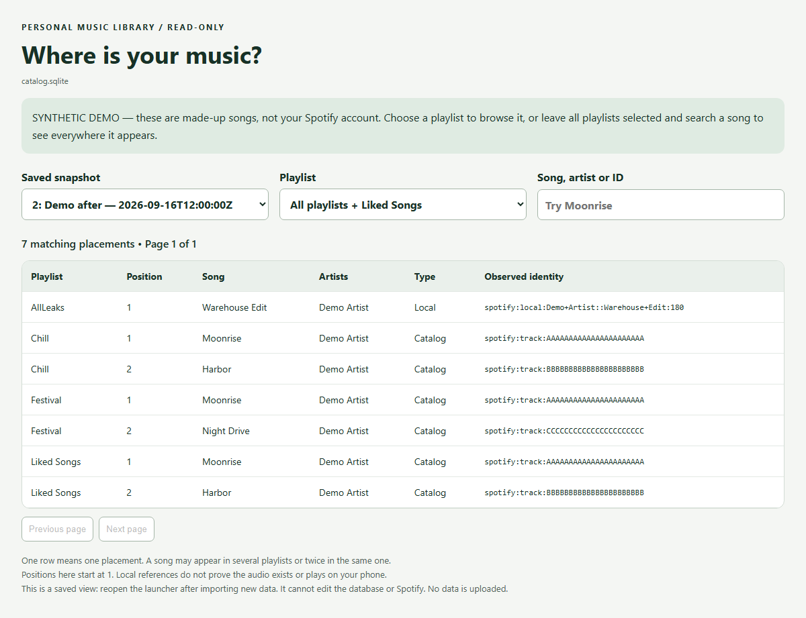

# Personal Music Library

Find every playlist a Spotify track appears in, see where playlists overlap, and compare what changed between captures. Personal Music Library turns playlist and Liked Songs metadata into a local catalog you can query offline.

- **Working today** — Resume interrupted Spotify captures, search track placements, compare snapshots, and export CSVs or a verifiable backup.
- **How it works** — Python and SQLite separate resumable capture from historical queries. The catalog preserves playlist order, duplicate placements, and which sources could be read, so incomplete data stays visible.
- **Try it offline** — Run `python library_demo.py` to compare two fictional snapshots and restore a backup. No Spotify login required.

[Technical case study](docs/PROJECT_OVERVIEW.md) · [Worked demo](docs/EXAMPLES.md) · [Setup and operations](docs/OPERATING_GUIDE.md)

It is not a Spotify replacement or audio archive. Spotify metadata does not include Spotify audio, and a local-track reference does not prove that a file exists or plays on a device. The longer-term direction is a personal music hub that bridges streaming metadata, owned audio, organization, and DJ-oriented enrichment; that work remains separate from the working catalog.

## Start small

Double-click **`Try offline demo.cmd`** for a synthetic, self-contained walkthrough. For completed real data, double-click **`Preview saved music.cmd`** for a read-only, bounded explorer. Neither changes Spotify.

The offline checkpoint export and playlist capacity report passed local
checks. Publication is the next step. The song-stats commands are on `main`,
with a separate task to refresh the underlying data.
[Current handoff](docs/WORK_STATUS.md#current-publication-status).
For manual New Music Friday curation, use Spotify folders to play across
numbered playlist volumes. See the [curation guide](docs/PLAYLIST_CURATION.md)
for the folder pilot and the [roadmap](docs/ROADMAP.md#next-work) for delivery order.

## What works today

| Need | Current behavior |
|---|---|
| Capture Spotify metadata | Read-only, resumable audit with durable SQLite checkpoints |
| Capture specific playlists | [Pass one link per `--playlist`](docs/OPERATING_GUIDE.md#capture-just-the-playlists-you-choose) and import or preview the result |
| Browse a small completed capture | Read-only HTML preview with placements, search, and two-playlist set operations |
| Keep history locally | Import snapshots into a separate SQLite catalog; prior snapshots remain intact |
| Find and compare | Search every occurrence; local union, intersection, difference, duplicate, and scan comparison |
| Inspect and protect | CSV exports, static catalog view, checksummed catalog ZIP, and restore verification |
| Preserve folders | Optional read-only Spotifast rootlist import; live validation still needed |
| Rank songs | [Playlist reach, personal plays, and worldwide streams](docs/OPERATING_GUIDE.md#song-stats) |
| Enrich recording genres | [Cache MusicBrainz recording tags](docs/METADATA.md#musicbrainz-recording-genres) for offline comparisons |
| Check playlist capacity | [Estimate remaining slots from saved captures](docs/OPERATING_GUIDE.md#playlist-capacity) |
| Investigate unavailable tracks | [Review saved playability and recovery evidence](docs/OPERATING_GUIDE.md#unavailable-tracks-and-recovery) |
| Repair shadow tracks | Guarded reviewed migration commands; offline-tested only |

Run `python library.py song-stats` after importing a playlist snapshot. The
ranking gives one point per distinct playlist plus one per known folder
category. Personal plays and worldwide stream totals have independent Spotify
and cross-service fields. Add an account-matched folder capture and import
listening history or dated service totals as they become available. The
[worked example](docs/EXAMPLES.md#rank-songs-and-import-stream-counts) shows
what each measure answers.

The [local audio-folder inventory](docs/LOCAL_INVENTORY.md) uses MP3 tags, filenames, and available WAV duration to find candidates for saved Spotify local references. Explicit file confirmations carry across scans by byte hash.

Not implemented: confirmed local recording matching, canonical recording matching across Spotify IDs, full-library scale validation, saved smart-playlist recipes, playlist publishing/splitting, player/server integration, or a universal playback/Connect replacement.

Planned [library intelligence](docs/LIBRARY_INTELLIGENCE.md) builds on that catalog: continuing change tracking, one-to-many playlist exploration, genre/BPM/key profiles, DJ transition candidates, and artist/album/future-release placement suggestions. The plan separates working queries from future features, metadata coverage, and provider-permission constraints.

The intended engine is your richly enriched personal database: capture and refresh metadata separately, then answer questions from stored tracks, albums, artists, memberships, and features. Those queries use local evidence with zero provider calls and show when it was last refreshed.

The shared long-term goal is a deeply organized, tagged library for DJing,
probably through rekordbox. The [DJ library workflow](docs/DJ_LIBRARY_WORKFLOW.md)
defines planned tagging, version identity, protection of cues and grids, and a
small import/export pilot. Obsidian is an optional Markdown workspace described
there; the catalog and DJ workflows do not depend on it.

**Local files and count discrepancies are core scope.** Current playlist scans preserve Spotify-returned local references, but do not inventory the desktop Local Files collection or verify phone files. The separate local inventory scans chosen folders and retains coverage gaps. Liked Songs API totals are observations of that endpoint, not a guarantee of matching desktop, web, phone, or Spotifast. The [identity taxonomy and count rules](docs/EVIDENCE_AND_MODEL.md#duplicate-and-identity-taxonomy) explicitly include ordinary single-versus-album duplicates with different track IDs, as well as shadow releases. Confirmed recording matching and device reconciliation remain planned.

## Non-negotiable boundaries

1. An occurrence is evidence: duplicate placements, order, failed coverage, local references, and snapshots are retained.
2. Unknown is not empty: an unreadable playlist or client disagreement is not a removal.
3. Catalog work is offline: only the explicit migration workflow can request a Spotify write, after review and `--execute`.

## Documentation map

| Read this | When you need it |
|---|---|
| [Operating guide](docs/OPERATING_GUIDE.md) | Scan, resume, import, query, preview, export, back up, or inspect folders |
| [Catalog explorer](docs/OPERATING_GUIDE.md#browse-the-saved-catalog) | Follow a song to exact placements, browse playlists, and filter imported folders |
| [Metadata coverage](docs/METADATA.md) | Inspect captured track, artist, release, and placement fields or plan local audio analysis |
| [Playlist curation](docs/PLAYLIST_CURATION.md) | Keep New Music Friday going with playlist volumes and test folder playback |
| [Evidence and data model](docs/EVIDENCE_AND_MODEL.md) | Interpret identities, coverage, local tracks, duplicates, or client disagreement |
| [Sharing local files](docs/SHARE_LOCAL_FILES.md) | Give a friend MP3 setup and phone-sync instructions without confusing them with catalog coverage |
| [Examples](docs/EXAMPLES.md) | Reproduce the supported offline walkthrough |
| [Migration](docs/MIGRATION.md) | Review or execute a shadow-track migration |
| [Roadmap](docs/ROADMAP.md) | Understand planned work and the broader app vision |
| [Library intelligence](docs/LIBRARY_INTELLIGENCE.md) | Assess continuing refresh, multi-playlist queries, enrichment, DJ suggestions, and artist/album placement |
| [DJ library workflow](docs/DJ_LIBRARY_WORKFLOW.md) | Plan tagging, rekordbox delivery, preparation preservation, and optional Obsidian use |
| [Historical observations](docs/HISTORICAL_OBSERVATIONS.md) | Review dated count/recovery evidence without confusing it for current coverage |
| [Integration design](docs/INTEGRATION_DESIGN.md) | Plan the migrator discovery handoff, folder adapter, and smart collections |
| [Storage decision](docs/STORAGE_DECISION.md) | Distinguish capture SQLite, historical catalog SQLite, browser recovery data, and future query optimization |
| [Reference projects](docs/REFERENCE_PROJECTS.md) | Compare Spotify Dedup and Spotify Song Relinker against our identity, local-file, and preservation requirements |

Requirements: Windows, Python 3.11+, and no third-party Python packages. A Spotify Developer app is needed only for a scan or migration. Copy `.env.example` to `.env`, set the public `SPOTIFY_CLIENT_ID`, and keep `.env` uncommitted. PKCE authentication does not use a Client Secret. A `--client-id` argument or environment variable can override the file.

Data defaults to `%USERPROFILE%\MusicLibraryData`, outside Documents/OneDrive; use `PERSONAL_MUSIC_LIBRARY_DATA`, `audit.py --output`, or `library.py --db` to choose another location.

The earlier topic-specific notes were consolidated so operations, evidence rules, and planned work each have one current source.

## Related project

[Spotify Playlist Migrator](https://github.com/mrdc1790/spotify-shadow-release-migrator) is a separate browser application for reviewed, explicit playlist and Liked Songs migrations. It shares the same safety principles but has its own codebase, OAuth flow, release cycle, and Git upstream. This repository is the long-lived catalog and evidence layer; neither repository imports code or data from the other at runtime.

The [shared integration roadmap](docs/CATALOG_MIGRATOR_ROADMAP.md) owns the ordered
repair work. The catalog owns discovery and evidence. The browser is the preferred
future interface for reviewed Spotify repairs. A manual repair trial and measured
benefit are prerequisites for the planned file bridge. Existing Python migration
commands retain their current restrictions.

### Implementation status reviewed October 27, 2026

The October 22 recovery work changed the **browser migrator**: persistent
IndexedDB checkpoints, resume/stop controls, visible progress/storage fallback,
and account-scoped recovery are preserved in its Git history. Those
features do not require this database to be finished. They are not a catalog
import, canonical recording resolver, or durable migration journal.

This library's Python code and SQLite schema were unchanged by that work and by
the October 27 documentation refresh. No new personal scan, catalog import,
enrichment, or database population was performed. Its existing capture/import,
history, and offline queries remain the starting point. Eleven catalog tests and
65 migrator tests passed on October 27; the October 22 browser recovery smoke test
used synthetic data. Authenticated validation of the supplied track pair remains
pending; these checks do not establish real account membership or a migration.

See the [current work status](docs/WORK_STATUS.md#continue-here) for the next
catalog milestone and the [handoff requirements](docs/INTEGRATION_DESIGN.md#catalog-to-migrator-discovery-handoff-planned)
for the deferred repair integration.
