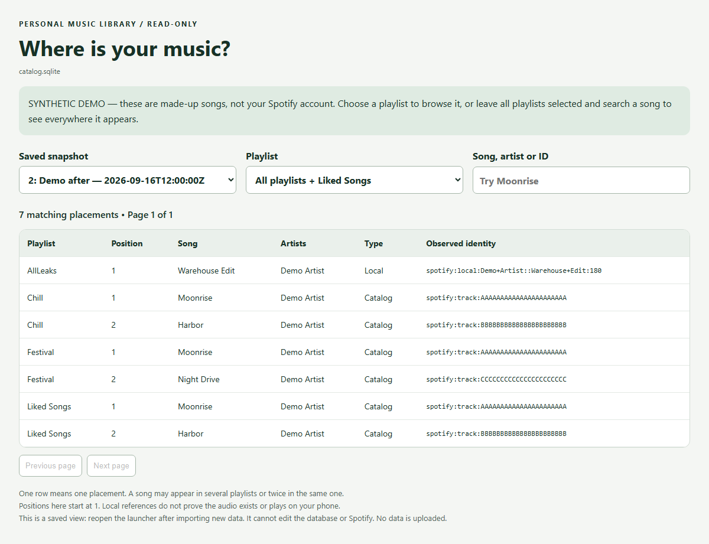

# Personal Music Library case study

Finding a track in Spotify is easy. Finding every copy of that track across playlists, or explaining which placements changed between two dates, takes more work. I built Personal Music Library to answer those questions from data I could inspect and keep locally.

## See it work

From the repository root with Python 3.11 or newer, run `python library_demo.py`. The demo creates two fictional captures and prints the folder with the SQLite catalog, CSV exports, comparison, and restored backup. It runs offline without a Spotify account.

| Question | Demo result |
| --- | --- |
| What do Chill and Festival share? | Moonrise |
| What is in Chill and absent from Festival? | Harbor |
| What changed between captures? | One of the two Moonrise placements in Chill was removed |
| Can the backup be restored? | The demo restores the ZIP to a second SQLite database |

To browse those placements, run `python view_catalog.py "path/to/catalog.sqlite"` with the `catalog.sqlite` file inside the demo's output folder. The viewer opens in a browser. Choose either snapshot and search for **Moonrise**.

## Engineering decisions

| Decision | Why it matters |
| --- | --- |
| Save capture progress and query history in separate SQLite databases | An interrupted API scan can resume from saved pages. Historical queries work without API access after import. |
| Store each observed track placement with its source and position | A set query can return one song while the catalog still remembers both copies and their positions. |
| Compare removals only where coverage supports the comparison | An unreadable playlist gives no reliable evidence that a track disappeared. Local-track references are also kept as metadata with their limits visible. |
| Keep Spotify edits behind a separate reviewed migration command | Searching, comparing, exporting, and restoring the catalog run locally. |

The current project includes resumable metadata capture, snapshot import and comparison, playlist set queries, a read-only HTML viewer, CSV exports, and checksummed backup and restore. Verified recording matches across different Spotify IDs and DJ tooling are future work.

## Start in the code

- Resumable capture and checkpoint storage. [`resumable_audit.py`](../resumable_audit.py)
- Snapshot import, catalog queries, comparison, and backup. [`library.py`](../library.py)
- Synthetic end-to-end example and catalog tests. [`library_demo.py`](../library_demo.py) · [`test_library.py`](../test_library.py)
- Coverage rules and identity choices. [Evidence and data model](EVIDENCE_AND_MODEL.md)
